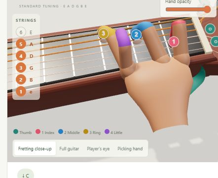
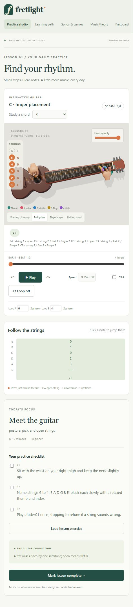

# Fretlight

A local guitar-learning web app with a procedural 3D acoustic guitar, animated fretting fingers, colored finger tape, and playback you can slow down and loop. Built with vanilla JavaScript, Three.js, Vite, Web Audio and PDF.js. No account or API key is required to use the app.

## Screenshots

### Guitar and finger placement



### Practice studio



Screenshots show the app running locally at a narrow browser width.

## Run locally

Install Node.js 22.12 or newer (Node 24 is used for local validation). In a terminal opened inside the project folder:

```sh
npm ci
npm run dev
```

Open the URL printed by Vite, normally **http://127.0.0.1:5173**. Keep that terminal open; press **Ctrl+C** to stop. Run `npm ci` on first setup or when dependencies change. On later visits, just run `npm run dev`.

### Windows launcher

Build once after cloning or after source updates:

```powershell
npm ci
npm run build
.\"Start Fretlight.cmd"
```

Alternatively, double-click **Start Fretlight.cmd** in the folder. It starts a hidden local server and opens **http://127.0.0.1:47831**. The launcher serves `dist`, which is generated by the build and is not committed to Git. The existing Desktop copy is already built.

The packaged build can run offline after dependencies are installed and it is built. The hidden server remains running until Windows exits or its Node process stops. Progress is browser-local and specific to the URL/port; use one launch method consistently.

## What you can practise

- **68 lessons** across beginner, foundation, intermediate, advanced and performance stages. Completion is self-reported; the app does not listen to or grade your real guitar.
- **41 playable pieces and studies**, **15 genres**, and **19 theory topics** with a searchable library.
- Chord studies, fretboard exploration, metronome, 25–125% speed, timeline seeking and A–B loops.
- Wrist-only teaching hands with adjustable opacity. Index is red, middle blue, ring gold, little finger purple and thumb green; contact markers use matching colors and finger numbers.
- Artist repertoire goals including Estas Tonne and Led Zeppelin. These are listening/learning targets, not bundled transcriptions of their recordings.
- Local PDF/photo review, editable tablature and uncompressed MusicXML import.

String 1 is thin high E and string 6 is low E. Finger numbers are 1 index, 2 middle, 3 ring and 4 little; 0 means open string. Standard tuning and a right-handed setup are currently supported. Advanced gestures and professional performance skill require real-instrument practice.

## Sheet import and its current limits

PDF and photo files are decoded locally. PDFs have page navigation. Experimental optical recognition handles only clear, horizontal, printed five-line treble staves and basic filled notehead candidates. It assumes guitar notation sounds an octave below written pitch. It does **not** reliably read complete scores: rhythm, rests, key signatures, accidentals, chords, ties, clef changes, handwritten notation, and photographic skew are not understood. Recognized notes are uniform quarter-note drafts, and false positives/missed notes remain possible. Review every note and duration against the source before playback. Pages are processed individually; drafts are not automatically combined across pages.

Editable notation and uncompressed MusicXML are also accepted. MusicXML uses the first part, supports divisions, chords, rests, backup/forward voice timing, technical string/fret/finger fields, and explicit chromatic/octave transpose. Repeats, ties, expressive articulations, tempo changes, and compressed MXL are not implemented. Unspecified string/fret placements are suggestions and can require manual correction. Without a transpose declaration or technical string/fret data, MusicXML pitches are treated as written and the app warns about guitar's octave convention.

Notation format (beats start at zero; durations are in quarter-note beats):

```text
# beat duration string:fret:finger ... direction
0 1 6:0 down
1 1 5:2:2 down
2 1 4:2:3 up
3 1
4 4 6:0 5:2:2 4:2:3 3:0 2:0 1:0 down
```

A line with no notes is a rest. Multiple notes on a line form a chord. ASCII tablature is interpreted on a uniform eighth-note column grid, which must be corrected if its spacing is not rhythmic. Save edited notation before leaving or refreshing the page.

The transparent hands are simplified articulated teaching models. Fingertip targets match the supplied positions for basic shapes, but complex barres, stretches, fingerstyle digit assignments, bends, slides, and lifelike hand biomechanics are not fully simulated. Generated plucked-string audio is synthetic, not recorded acoustic samples. Playback speed changes timing without transposing notes. The timeline seeks backward; it does not play audio in reverse.


## Development and validation

```sh
npm test
npm run build
```

39 Node tests cover notation, curriculum references, timing and loop behavior, finger tape, common chord contacts, barre surface proximity, transformed pick contact and an A Dorian pitch regression. The production build passes. Browser checks covered colored fingers, chord study, lesson navigation and library search. These checks do not establish lifelike biomechanics or reliable recognition of arbitrary sheet photos.

The guitar and hands are original procedural teaching geometry, not scanned photoreal models. Audio uses synthetic plucked strings. The current picking animation does not demonstrate every fingerstyle, percussion, bend or rasgueado technique.

## References

- [Three.js skeletal meshes](https://threejs.org/docs/pages/SkinnedMesh.html)
- [MusicXML technical fingering](https://www.w3.org/2021/06/musicxml40/musicxml-reference/elements/fingering/)
- [PDF.js](https://github.com/mozilla/pdf.js)
- [Estas Tonne official music](https://www.estastonne.com/)
- [Led Zeppelin official site](https://www.ledzeppelin.com/)
